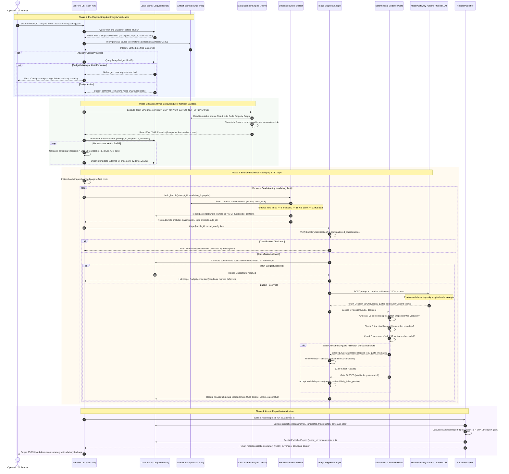

# VeriFlow Scan & Advisory Sequence

This document provides a detailed visual and architectural sequence diagram for the **Scan and Advisory Pipeline** in **VeriFlow**.

It details how an admitted source run transitions through snapshot integrity verification, isolated static taint scanning (Joern), candidate fingerprinting, evidence bundling, pre-execution budget reservations, and deterministic evidence-gate triage using generative AI models.

---

## Complete Scan and Advisory Sequence Diagram

---

## Detailed Sequence Phases & Code Reference Anchors

### Phase 1: Pre-Flight & Snapshot Integrity Verification
* **CLI Trigger:** [`src/veriflow/cli.py:L497-L557`](file:///Users/eric/PycharmProjects/traceproof/src/veriflow/cli.py#L497-L557) (`scan_run_command`)
* **Integrity Validation:** [`src/veriflow/indexing.py:L31-L38`](file:///Users/eric/PycharmProjects/traceproof/src/veriflow/indexing.py#L31-L38) (`verified_source()`).
* **Budget Pre-Check:** [`src/veriflow/scan_advisory.py:L39-L43`](file:///Users/eric/PycharmProjects/traceproof/src/veriflow/scan_advisory.py#L39-L43) (`AdvisoryOptions.validate_budget()`).
* **Guarantee:** Guarantees that neither scanner nor model operates on unverified or tampered source code, and halts early if no triage budget has been allocated.

### Phase 2: Static Analysis Execution (Zero-Network Sandbox)
* **Execution Runner:** [`src/veriflow/joern.py:L36-L73`](file:///Users/eric/PycharmProjects/traceproof/src/veriflow/joern.py#L36-L73) (`stage()`).
* **Network Revocation:** Environment variables `GOPROXY="off"`, `GOSUMDB="off"`, and `CARGO_NET_OFFLINE="true"` ensure no dependencies are downloaded during scan execution.
* **Candidate Fingerprinting:** [`src/veriflow/sarif.py:L60-L66`](file:///Users/eric/PycharmProjects/traceproof/src/veriflow/sarif.py#L60-L66) (`fingerprint()`).
* **Guarantee:** Alerts are persisted as unreviewed candidates with content-addressed fingerprints, preventing line number shifts from creating duplicate alerts.

### Phase 3: Bounded Evidence Packaging & AI Triage
* **Evidence Bundling:** [`src/veriflow/bundles.py:L44-L105`](file:///Users/eric/PycharmProjects/traceproof/src/veriflow/bundles.py#L44-L105) (`_build_bundle()`).
  * Hard limits enforced: Maximum 8 locations, $\le$16 KiB total source text, and $\le$32 KiB total payload.
* **Classification Gating:** [`src/veriflow/triage.py:L110-L111`](file:///Users/eric/PycharmProjects/traceproof/src/veriflow/triage.py#L110-L111).
  * Verifies `bundle["classification"] in config.allowed_classifications`.
* **Budget Ledger Reservation:** [`src/veriflow/triage.py:L149-L185`](file:///Users/eric/PycharmProjects/traceproof/src/veriflow/triage.py#L149-L185).
* **Deterministic Verification Gate:** [`src/veriflow/claims.py:L300-L360`](file:///Users/eric/PycharmProjects/traceproof/src/veriflow/claims.py#L300-L360) (`assess_evidence()`).
  * Validates quoted strings verbatim against snapshot bytes; forces `verdict = "abstain"` if quotes do not match.
* **Guarantee:** LLMs never receive full codebases, cannot run away with cloud costs, and cannot hallucinate sanitizers or code that does not exist.

### Phase 4: Atomic Report Materialization
* **Summary Assembly:** [`src/veriflow/reports.py:L52-L250`](file:///Users/eric/PycharmProjects/traceproof/src/veriflow/reports.py#L52-L250) (`projection()`).
* **Immutable Persistence:** [`src/veriflow/reports.py:L252-L287`](file:///Users/eric/PycharmProjects/traceproof/src/veriflow/reports.py#L252-L287) (`publish_report()`).
* **Guarantee:** Reports are immutable and versioned (`version = 1 + max(version)`). Machine findings, human operator reviews, and AI model advice remain strictly separated.
